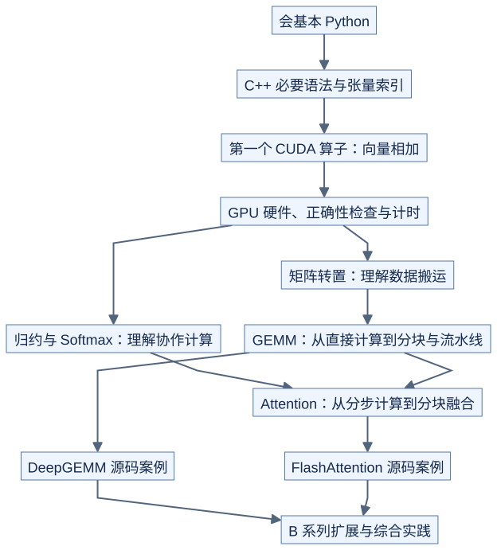

# GPU Kernels Learning

**从 Python 出发，在 H20 上学习 CUDA 算子，并逐步读懂高性能 GEMM 与 Attention 实现。**

面向会基本 Python、没有写过 GPU 算子、对 C++ 不熟悉的同学。通过图解、完整代码和可复现实验，学习数据如何移动、线程如何分工，以及代码为什么变快。

> 当前状态：已补充背景知识、GEMM / Attention 理论、原理图、自测题和纯 Python 数学检查。当前没有实际 GPU 环境，优先完善理论；完整 CUDA 实验、交互演示和 GPU 实测结果尚未提供。

## 学完能做什么

- 写出完整 CUDA 算子，验证结果并处理边界输入。
- 看懂 GPU 参数，理解硬件资源如何影响代码。
- 测量性能、定位主要耗时，解释一次优化为何有效或无效。
- 沿 GEMM 和 Attention 两条主线，阅读并修改现代高性能实现。

## 学习路线



[图源](figures/readme-01.mmd)

图中 GEMM 指矩阵乘法；归约指把一组数合成一个结果，例如求和；Softmax 把一组分数转换为和为 1 的权重。其余必要名称在对应章节首次出现时配图解释。

详细顺序与阶段验收见 [学习路线](docs/roadmap.md)。

## 从这里补齐背景

先读 [背景知识入口](docs/prerequisites/README.md)，再进入算子实验。每篇围绕一个问题，包含图示、例子和自测。

| 主题 | 阅读入口 |
| --- | --- |
| 从 Python 到 C++ | [类型、指针、数组和 kernel 启动](docs/prerequisites/01-python-to-cpp.md) |
| 张量如何存储 | [shape、stride、转置与广播](docs/prerequisites/02-tensors-and-layout.md) |
| 计算所需数学 | [归约、GEMM、Softmax 与 Attention](docs/prerequisites/03-math-for-kernels.md) |
| 数值正确性 | [浮点精度、累加顺序与误差判断](docs/prerequisites/04-floating-point.md) |
| GPU 如何执行 | [线程、warp、block 与 SM](docs/hardware/execution.md) |
| 数据如何移动 | [显存、缓存、共享内存与寄存器](docs/hardware/memory.md) |
| 协作与等待 | [块内同步、stream、event 与原子更新](docs/prerequisites/05-synchronization.md) |
| 如何判断性能 | [计算量、数据量、计时与分析工具](docs/methodology/performance-basics.md) |
| 从源码到执行 | [软件栈与编译流程](docs/software-stack/README.md) |

内容参考 NVIDIA 官方文档、PyTorch 官方说明及 GitHub 代码资料。按章节选读的来源见 [资料导航](docs/references.md)。

## 当前没有 GPU，也可以继续学

- [GEMM 分块与流水线](lessons/03-gemm/README.md)：理解复用、Tensor Core 与等待关系。
- [Attention 逐块计算](lessons/04-attention/README.md)：手算 Softmax 更新和输出累加。
- [经典算子的计算方式](lessons/02-hardware-and-profiling/operator-patterns.md)：归约、前缀和、归一化与融合。
- [资源预算](docs/hardware/resource-budget.md)与[经典算子逐步推导](lessons/02-hardware-and-profiling/README.md)：手算优化收益与代价。
- [固定版本源码阅读](case_studies/README.md)：DeepGEMM、FlashAttention、SOLAR 与 KDA 案例。

从仓库根目录运行，只需 Python 标准库：

```bash
python3 tools/check_theory.py
python3 tools/check_patterns.py
python3 tools/check_attention_backward.py
python3 tools/check_resource_budget.py
python3 tools/check_classic_operators.py
python3 tools/check_docs.py
```

前五个脚本检查数学、索引和资源估算，最后一个检查文档和图源；均不模拟 GPU，也不输出性能成绩。

## 如何学习一节课

每节课围绕一个主要问题展开：

| 步骤 | 看什么 | 做什么 |
| --- | --- | --- |
| 计算定义 | 小尺寸输入、输出和对应关系 | 用 Python 写出参考结果 |
| 直接实现 | 线程与数据的对应图 | 运行最简单的正确版本 |
| 性能测量 | 实测耗时与数据搬运量 | 检查哪里花时间 |
| 逐步优化 | 修改前后的并排图 | 每次改变一个主要因素 |
| 验证结论 | 正确性结果与性能图 | 说明收益、代价与适用范围 |

先看图和结论，再读代码；详细推导放在可展开部分。图示规范见 [图解约定](docs/visual-guide.md)。

## 硬件与软件

**H20 是主线实验平台，B 系列是进阶扩展。** 不同型号的参数和结果分别记录，不把一个系列视作同一块 GPU。

| 范围 | 计划内容 | 当前状态 |
| --- | --- | --- |
| H20 主线 | 基础算子、GEMM、Attention、数据搬运与计算重叠 | 待实现、待实际设备验证 |
| B 系列扩展 | 对应硬件能力、实现差异与上游案例 | 待选定具体型号、待验证 |
| 无 GPU 学习 | 图解、自测、Python 数学检查 | 已提供初版；浏览器交互演示待补 |

硬件资料将分别记录官方参数和本机实测值，包含具体型号、来源、核验日期与软件环境。见 [硬件入口](docs/hardware/README.md)。

- **实现主线：CUDA C++。** C++ 语法随实验补齐，不要求先学完整语言。
- **验证与实验：Python、PyTorch、pytest。** 负责生成输入、比对结果和批量测量。
- **进阶阅读：CUTLASS、CuTe / CuTe DSL。** 随现代实现案例引入。
- **对照实现：Triton。** 选择代表性算子，不要求每个实验维护多个后端。
- **构建与分析：CMake、CUDA Events、Compute Sanitizer、Nsight。** 按学习阶段逐步介绍。

版本将在实际 H20 环境验证后锁定；上游案例使用独立环境，避免增加入门实验的安装负担。见 [环境配置](docs/setup/README.md) 和 [软件栈说明](docs/software-stack/README.md)。

## 章节与实验计划

背景讲解已有初版；以下完整 GPU 实验仍在 **规划中**，目录存在不代表代码已经实现。

| 顺序 | 章节 | 核心问题 | 入口 |
| --- | --- | --- | --- |
| 00 | 必要背景 | Python 的数组如何对应到 C++ 内存与张量索引？ | [先修知识](lessons/00-prerequisites/README.md) |
| 01 | CUDA 入门 | 如何让多个线程共同完成计算？ | [入门课程](lessons/01-cuda-basics/README.md) |
| 02 | 硬件与测量 | 数据放在哪里，如何正确测量耗时？ | [硬件与分析](lessons/02-hardware-and-profiling/README.md) |
| 03 | GEMM | 如何减少重复读取并提高计算效率？ | [GEMM 课程](lessons/03-gemm/README.md) |
| 04 | Attention | 如何减少中间结果存储并保持数值正确？ | [Attention 课程](lessons/04-attention/README.md) |
| 05 | 综合实践 | 如何对真实输入完成一次有证据的优化？ | [综合实践](lessons/05-capstone/README.md) |

### GEMM 主线

直接计算 → 共享内存分块 → 寄存器复用 → 数据布局优化 → Tensor Core → 搬运与计算重叠 → 高级调度与源码阅读。

每一步保留可对照的实现，记录哪些输入变快、哪些输入可能变慢。见 [GEMM 实验](kernels/gemm/README.md)。

### Attention 主线

Python 参考 → 分步计算 → 逐块更新 Softmax → 分块融合 → 线程分工优化 → 现代实现阅读。

首版聚焦前向计算，再加入 causal（只看当前位置及之前的位置）和 GQA（多组查询共享键和值）；后续扩展逐 token 生成、变长输入与反向计算。见 [Attention 实验](kernels/attention/README.md)。

### 其他经典算子

| 算子 | 学习重点 |
| --- | --- |
| 矩阵转置 | 连续读写、共享内存布局 |
| 求和 / 求最大值 | 线程协作、分步合并结果 |
| Softmax | 数值稳定、读取次数与归约 |
| LayerNorm / RMSNorm | 行内统计、数据复用 |
| 前缀和 | 如何计算每个位置之前的累计结果 |
| RoPE | 位置编码中的数据读取与成对计算 |
| 量化 | 缩放、精度误差与数据布局 |
| 算子融合 | 减少中间数据和启动次数 |

矩阵转置、归约与 Softmax 会在主线需要它们之前学习。见 [经典算子实验](kernels/operators/README.md)。

## 完整实验的标准

一个实验只有满足以下要求，才会标记为已验证：

1. 说明计算公式、输入输出、支持的尺寸、数据类型与内存布局。
2. 提供完整实现、必要的调用代码和独立参考结果。
3. 测试正常输入、不能整齐分块的尺寸及有意义的数值边界。
4. 明确误差容忍范围；不支持的输入明确拒绝。
5. 提供预热、正确同步的计时，对比上一版实现和适用的成熟库。
6. 记录 GPU 型号、软件版本、代码版本、运行命令和原始结果。

“代码已提供”“正确性已验证”“性能已实测”分别标记。没有 GPU 的检查不能算 CUDA 测试通过；性能结论仅适用于已记录的硬件和输入。详细要求见 [实验与验证规范](docs/methodology/README.md)。

## 目录结构

```text
GPU_Kernels_Learning/
├── README.md
├── CONTRIBUTING.md
├── docs/                   # 背景、环境、硬件、软件与图解规范
├── lessons/                # 按学习顺序导航
├── kernels/                # 自包含实验：说明、图、实现、测试、测量
│   ├── basics/
│   ├── gemm/
│   ├── attention/
│   └── operators/
├── case_studies/            # 固定上游版本的源码阅读与复现
├── common/                 # 逐步抽取公共辅助代码
├── tools/                  # 环境检测、批量验证、结果绘图
├── configs/                # GPU 参数、输入集合、误差配置
├── environments/           # 分阶段环境与版本锁定
└── results/                # 实测数据与环境记录
```

`lessons/` 管学习顺序，`kernels/` 存实验本身，`case_studies/` 解释与上游源码的对应关系。图和交互演示放在对应实验附近。

## 参考材料

| 项目 | 在本课程中的用途 |
| --- | --- |
| [CUDA 120 Days](https://github.com/AdepojuJeremy/CUDA-120-DAYS--CHALLENGE) | 基础知识覆盖、练习与阶段验收参考 |
| [KDA](https://github.com/NVlabs/kda) | 任务定义、验证和迭代流程参考 |
| [SOLAR](https://github.com/NVlabs/SOLAR) | 计算量、数据量与性能上界分析案例 |
| [KDA-Pilot](https://github.com/BBuf/KDA-Pilot) | 真实输入、基线、日志与结果审查案例 |
| [FlashAttention](https://github.com/dao-ailab/flash-attention) | Attention 算法与工程实现案例 |
| [DeepGEMM](https://github.com/deepseek-ai/DeepGEMM) | 现代矩阵乘法与架构特化案例 |

参考链接不表示已完成复现。案例落地时固定上游 commit，注明来源与适用许可证。

## 建设顺序

- [x] 确定读者、硬件主线与教学方式。
- [x] 建立 README、课程入口与目录骨架。
- [x] 补充背景知识初版：图解、自测与官方/代码资料导航。
- [x] 补充 GEMM / Attention 理论初版与 CPU 数学检查。
- [x] 补充线程布局、低精度、RoPE、归约与前缀和理论。
- [x] 补充 GQA、Decode 和最简 Attention 反向推导。
- [x] 建立固定版本源码阅读初版与无 GPU 综合作业。
- [x] 补齐资源预算、转置、归一化与融合的逐步推导和 CPU 验证。
- [ ] 完成 vector add 图解样章；GPU 可用后补齐 CUDA 验证与计时。
- [ ] 在实际 H20 上验证环境，记录设备参数。
- [ ] 完成转置、归约和 Softmax 基础实验。
- [ ] 完成 GEMM 优化链与 Attention 前向主线。
- [ ] 补充经典算子、上游案例和 B 系列扩展。

参与方式见 [贡献约定](CONTRIBUTING.md)。
