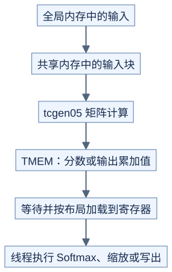

# Blackwell：矩阵中间结果多了一个存储位置

**SM100 的 Tensor Memory 需要单独分配和交接，不能当作普通寄存器或共享内存。** 前置：[Hopper 交接规则](hopper-pipeline.md)、[线程布局](../../lessons/03-gemm/03-thread-layout.md)。本页选择 SM100 教学路径；其他 B 系列与消费级 Blackwell 必须核对各自能力。

## 1. 先看数据去哪里



[图源](figures/blackwell-matmul-01.mmd)

Tensor Memory，简称 TMEM，是第五代 Tensor Core 使用的专用片上存储。普通线程通过专用加载/存储指令访问允许的位置，不能用普通全局内存指针替代。`tcgen05` 是这一代指令的命名前缀。[PTX 第五代 Tensor Core](https://docs.nvidia.com/cuda/parallel-thread-execution/index.html#tensorcore-5th-generation-instructions)

## 2. 与 Hopper 的阅读区别

| 问题 | Hopper WGMMA 常见路径 | SM100 tcgen05 路径 |
| --- | --- | --- |
| 谁发出计算 | 约定的 4-warp 协作组 | 按具体指令规定的发起者与 CTA 组 |
| 累加值在哪 | 寄存器 | TMEM |
| 普通线程如何用结果 | 等待对应组完成后访问寄存器 | 等矩阵完成，再用 TMEM 读取及其完成规则 |
| 新增预算 | 寄存器、共享内存等 | 还需计算 TMEM 列占用 |
| 跨块协作 | 依赖所选 cluster 实现 | 可选单 CTA/双 CTA 矩阵路径，必须匹配布局与同步 |

CTA 就是线程块。双 CTA 路径不是随便把两个块拼起来；相关输入分布、参与范围与同步由所选指令和库规定。[CUTLASS SM100 功能表](https://docs.nvidia.com/cutlass/latest/media/docs/cpp/blackwell_functionality.html)

## 3. 多算一份 TMEM 预算

SM100 的 TMEM 以列分配，文档给出的每 CTA 结构是 128 行、512 列、每格 32 位；分配列数以 32 列为单位并满足二次幂规则。这里的“行”是硬件布局，不能直接等同于任意逻辑矩阵的行。

教学例子：若选定布局让中间分数占 128 列、输出占 128 列，它们同时存活就需 256 列。若再增加 128 列，384 的需求要按规则申请到 512 列；不是只增加了 128 列物理分配。能否复用区域取决于旧使用者是否全部完成，不能只看数组名不同。

## 4. 一次计算的检查顺序

```text
原理示意，不是可运行指令模板

按规则分配 TMEM → 发布可用地址
等待输入就绪 → 发起矩阵计算 → 等矩阵完成
线程按约定布局加载结果 → 等加载完成 → 做 Softmax/缩放/输出
确认全部使用者结束 → 释放 TMEM
```

矩阵计算的完成通知、TMEM 加载完成和数据区域可复用是不同条件。需要检查 `tcgen05.commit` 关联的 barrier，以及加载/存储的等待与顺序规则；不要直接套用 `wgmma.wait_group`。矩阵操作与普通线程的寄存器、共享内存操作仍需满足对应可见性要求。

## 5. 编译目标也是约定的一部分

文件名 `sm100` 不代表所有 Blackwell 都能运行。架构专用目标和带架构/家族功能的目标有各自兼容范围；核对 GPU 计算能力、CUDA/CUTLASS 版本、目标后缀和具体指令支持表。升级编译目标不是移植算法的充分条件。[Blackwell Tuning Guide](https://docs.nvidia.com/cuda/blackwell-tuning-guide/index.html)

## 自测与验证

分数区和输出区各 128 列，两份输出同时存活，申请 256 列够吗？

<details>
<summary>答案</summary>

不够。总需求 384 列，按本页分配规则需 512 列，除非证明某些区域生命周期不重叠，能安全复用。

</details>

[check_pipeline_protocol.py](../../tools/check_pipeline_protocol.py) 复算列预算和抽象完成顺序；真实 TMEM 布局和指令合法性仍待编译及 GPU 验证。继续阅读 [FlashAttention SM100 的实际分工](../../case_studies/architecture-walkthrough.md)。
