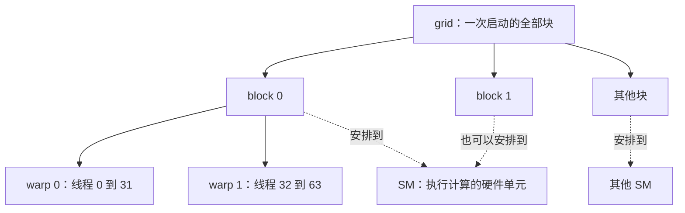

# 线程与 GPU 执行：任务分组不等于硬件数量

**程序创建很多线程，硬件分批执行它们。**



原理示意，图中每块选用 64 个线程。一块的线程在同一 SM 上执行；资源允许时，同一 SM 可以容纳多个块。warp 是块内 32 个线程组成的执行分组。块的执行先后通常没有保证。[NVIDIA 编程模型](https://docs.nvidia.com/cuda/cuda-programming-guide/01-introduction/programming-model.html)

## 从编号找到工作

一维索引为 `i = blockIdx.x * blockDim.x + threadIdx.x`。例如每块 64 个线程，块 2 中线程 5 的全局索引是 133。二维矩阵通常分别计算行列索引，再按照张量步长定位内存。

线程不是一颗永久独占的 CUDA core。线程块数量也不必等于 SM 数量；让同一块处理一个数据分块，是程序设计选择。

## 为什么有很多线程仍可能慢

```text
原理示意：SM 可以从准备好的 warp 中选择工作

warp A：发起读取 → 等数据 ─────────→ 使用数据
warp B：             可执行计算
warp C：                         可执行计算
```

足够多的可执行工作能帮助覆盖等待，但每个块会占用寄存器和共享内存。每线程保存的值越多、每块使用的共享内存越大，可能同时容纳的块就越少。

occupancy 指实际驻留的 warp 数相对于硬件上限的比例，不是 GPU 算力利用率。它高不代表一定快；也要看数据复用、指令依赖和实际耗时。[NVIDIA 性能实践](https://docs.nvidia.com/cuda/cuda-c-best-practices-guide/index.html#occupancy)

## 同一个 warp 走不同分支

```text
原理示意：只画 8 个位置，实际 warp 有 32 个

线程：0 1 2 3 4 5 6 7
路径 A：✓ ✓ ✓ ✓ · · · ·
路径 B：· · · · ✓ ✓ ✓ ✓
```

不同路径会让部分位置在某段指令中不工作，这叫分支分歧。不要推导成“所有 if 都慢”：整个 warp 作相同选择，与 warp 内部选择不同是两种情况。[NVIDIA 编程模型](https://docs.nvidia.com/cuda/cuda-programming-guide/01-introduction/programming-model.html#warps-and-simt)

## 自测

一个 GPU 有若干 SM，能否启动比 SM 数量更多的块？可以。它们会按可用资源执行，不需要程序逐批启动。

下一篇：[存储与数据访问](memory.md)。
