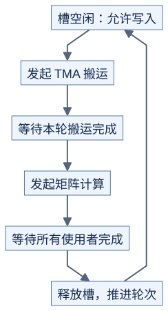

# Hopper：搬完、算完、可覆盖是三件事

**异步操作发出以后，必须等它对应的完成信号。** 前置：[同步](../prerequisites/05-synchronization.md)、[GEMM 流水线](../../lessons/03-gemm/02-tensor-core-and-pipeline.md)、[资源预算](resource-budget.md)。这里讲交接规则，不提供可直接执行的 PTX 模板。

## 1. 把搬运和计算分工

TMA 是批量搬运张量的硬件机制：根据描述信息把一块数据搬到共享内存。描述信息包含基址、尺寸、步长和布局等；设置必须符合具体指令的类型、对齐和形状要求。与逐元素搬运相比，它能减少线程参与地址计算和中转的工作。[Hopper Tuning Guide](https://docs.nvidia.com/cuda/hopper-tuning-guide/index.html)

搬运线程先确认缓冲区空闲，再发起操作；计算线程等数据可读后开始计算。部分 warp 专门搬运、其他 warp 专门计算，叫 warp specialization，即按 warp 分工。增加搬运线程不必然让 TMA 更快。

## 2. 一轮缓冲区怎样交接



[图源](figures/hopper-pipeline-01.mmd)

| 动作 | 源码里常见的名字 | 它保证什么 |
| --- | --- | --- |
| 等待可写 | producer_acquire / empty barrier | 上一轮使用者已释放 |
| 提交搬运 | TMA copy、登记预期传输量 | 发出任务，还没保证搬完 |
| 等待可读 | consumer_wait / full barrier | 本轮要求的数据已准备好 |
| 提交矩阵运算 | WGMMA、commit_group | 发出计算，还没保证算完 |
| 等计算完成 | wait_group 或库对应封装 | 对应计算不再使用输入，结果可按规则读取 |
| 释放缓冲 | consumer_release | 允许后续轮次覆盖 |

这些名字来自不同层次，不能互换当作 API。某些库把预期字节登记或完成通知封装在 pipeline 内；不应额外重复通知。[CUTLASS 同步原语](https://docs.nvidia.com/cutlass/latest/media/docs/cpp/pipeline.html)

## 3. 两个缓冲区为什么还需要轮次

```text
原理示意
K块编号       0     1     2     3     4
缓冲槽        0     1     0     1     0
使用轮次      0     0     1     1     2
phase示意     0     0     1     1     0
```

只检查“槽 0 曾经搬完”不够，必须等本轮搬完。实现常用 phase 翻转区分循环中的相邻轮次，并靠协议防止生产者追上尚未释放的数据；单独一位 phase 不是任意长历史的版本号。生产端和消费端初始 phase 可能不同，阅读时跟踪初始化及翻转位置，不能统一填 0。

多个计算组都读同一块数据时，要等最后一个使用者完成再释放。循环退出也要收尾：所有在途访问完成后，才能复用存储或让涉及协作的块退出。

## 4. WGMMA 与普通线程代码如何相接

WGMMA 是 Hopper 上由一组 4 个 warp 协作的异步矩阵乘加。常见路径用共享内存描述符指向输入，用寄存器保存累加结果；具体输入放在哪取决于指令变体。

阅读 PTX 时分清三种动作：寄存器访问顺序的 `wgmma.fence`，打包先前矩阵指令的 `commit_group`，等待已提交组完成的 `wait_group N`。N=0 等所有先前已提交组；N=1 允许最近至多一组仍在执行，不能随意读取它的结果。`.sync` 字样也不表示异步乘法已经完成。[PTX WGMMA 说明](https://docs.nvidia.com/cuda/parallel-thread-execution/index.html#asynchronous-warpgroup-level-matrix-multiply-accumulate-instructions)

## 5. 还有一种“可见”不能漏

普通线程写共享内存后，让 TMA 或矩阵硬件读取时，还要满足普通访存与异步访问之间的顺序。文档把不同访问机制叫 proxy；`fence.proxy.async` 等负责连接这些机制。它不是“等计算结束”，也不能代替正确的搬运完成等待。

先确认数据由谁写、由谁读，再按官方对应方向的示例检查初始化、可见性和完成机制。TMA 全局到共享通常通过共享内存 barrier 等待；共享到全局有不同的完成规则，不能照搬同一套等待。[CUDA 异步搬运](https://docs.nvidia.com/cuda/cuda-programming-guide/04-special-topics/async-copies.html)

## 自测与验证

TMA 已搬完，WGMMA 刚发出，能立刻把该共享块覆盖成下一轮输入吗？

<details>
<summary>答案</summary>

不能。矩阵硬件可能还在读取共享块。必须确认所有相关计算使用者已完成，再释放；普通线程走到下一行不构成这个证明。

</details>

[check_pipeline_protocol.py](../../tools/check_pipeline_protocol.py) 检查抽象交接顺序，故意插入提前读取、覆盖、漏释放和旧轮次通知。它不是 CUDA 内存模型或 PTX 仿真器。源码对照见 [架构实现逐段阅读](../../case_studies/architecture-walkthrough.md)。
