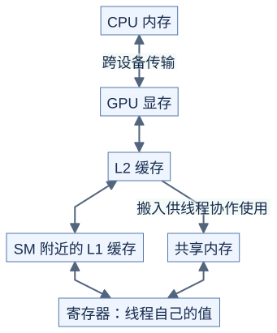

# 存储与数据访问：少搬数据，重复使用

**同一个数能在近处重复使用，就少一次远处读取的需要。**



[图源](figures/memory-01.mmd)

原理示意：表示用途与数据流，不是所有指令都经过每个框；具体路径随指令和架构变化。L1/L2 主要由硬件管理，共享内存由程序明确安排读写。[NVIDIA 编程模型](https://docs.nvidia.com/cuda/cuda-programming-guide/01-introduction/programming-model.html#gpu-memory)

| 位置 | 谁使用 | 常见用途 | 需要注意 |
| --- | --- | --- | --- |
| 显存 | 设备上的线程 | 输入、输出、大数组 | 重复搬运可能昂贵 |
| 共享内存 | 通常同一块的线程 | 交换与复用数据块 | 容量有限，需要同步 |
| 寄存器 | 单个线程 | 索引、中间结果 | 使用过多会影响资源分配 |
| L1 / L2 | 缓存近期访问 | 减少远处读取 | 不能假定每次都命中 |

CUDA 的 local memory 虽叫“局部”，其底层位于设备内存，并非一定快。寄存器放不下的值可能被放到这里。[NVIDIA SIMT kernel 指南](https://docs.nvidia.com/cuda/cuda-programming-guide/02-basics/writing-cuda-kernels.html)

## 相邻线程读取相邻数据

```text
原理示意：只画四个线程

线程编号       0    1    2    3
连续读取       0    1    2    3   ← 地址集中
大跨度读取     0   32   64   96   ← 地址分散
```

硬件以成段的方式读取内存。同一个 warp 的访问集中且对齐时，通常能用更少的数据传输满足请求，这叫合并访存。关键是同一条读取指令下不同线程的地址关系，不只是一个线程自己的访问顺序。[NVIDIA 合并访存说明](https://docs.nvidia.com/cuda/cuda-c-best-practices-guide/index.html#coalesced-access-to-global-memory)

## 共享内存也可能排队

共享内存分成多个 bank，可以理解为多个可并行服务的存储分区。以连续 32 位数据和 32 个 bank 为例：

```text
原理示意：bank = 元素偏移 % 32

float tile[32][32] 的第 0 列：偏移 0,32,64,... → 同一 bank 的不同地址
float tile[32][33] 的第 0 列：偏移 0,33,66,... → 分散到不同 bank
```

在这个特定的列读取模式下，多加一列可以减少冲突。多个线程读取同一个地址还存在广播情形，不能把它等同于读取同一 bank 的不同地址。其他类型与访问方式应重新分析。[NVIDIA 共享内存说明](https://docs.nvidia.com/cuda/cuda-c-best-practices-guide/index.html#shared-memory-and-memory-banks)

## 为什么 GEMM 适合分块

同一块 A 会参与多个输出列，同一块 B 会参与多个输出行。将它们搬入共享内存后重复使用，可以减少显存请求；每线程再保留几个结果，就能进一步复用已读取的值。分块变大同时占用更多资源，因此要测量，而不是一味增大。

自测：向量相加每个输入只用一次，先搬到共享内存一定更快吗？不一定，它可能只增加搬运和同步。

下一篇：[同步与异步](../prerequisites/05-synchronization.md)。
