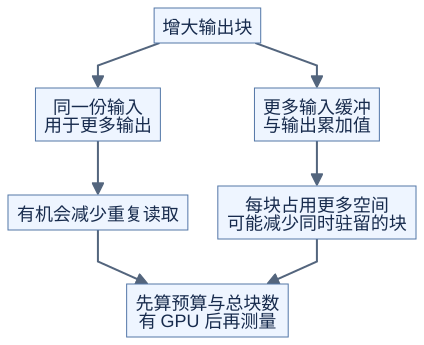

# 从硬件资源算到分块选择

**先排除放不下的方案，再比较复用与并行机会。** 前置：[线程与执行](execution.md)、[GEMM 分块](../../lessons/03-gemm/01-tiling.md)。当前没有 H20，以下是设计练习，不是推荐配置或性能预测。

## 1. 一块计算占用哪些空间



[图源](figures/resource-budget-01.mmd)

设输出块为 BM×BN，每轮沿 K 取 BK 个元素，输入每元素 b 字节，准备 S 组搬运缓冲区：

```text
共享内存中的输入 = S × (BM×BK + BK×BN) × b
每轮矩阵运算数   = 2 × BM × BN × BK
输入复用比       = 运算数 / 单轮输入字节数
```

复用比只计 A、B 的块内读取，忽略输出、尾块、缩放、缓存与其他操作。S 增加会多占空间，不会减少本轮必须搬运的输入。

若输出以 FP32 留在寄存器中，BM×BN 个累加值平均分给 T 个线程，就需要每线程 `BM×BN/T` 个 32 位寄存器存放累加值。地址、输入片段和临时结果也要空间；不同线程分工不均时，不能用平均数当实际用量。

## 2. 用同一份预算比较三个候选

练习假设：每 SM 可用共享内存 **128 KiB**、寄存器 **65,536 个**、线程 **2,048 个**、块数上限 **32**；每块 256 线程，输入每元素 2 字节。这里 KiB=1024 字节，预算刻意简化，**不是 H20 参数卡**。

| 候选 | BM×BN×BK | 缓冲区 S | 输入共享内存 | 平均累加寄存器/线程 | 假设总寄存器/线程 |
| --- | --- | --- | --- | --- | --- |
| A | 64×64×32 | 2 | 16 KiB | 16 | 40 |
| B | 128×128×32 | 2 | 32 KiB | 64 | 80 |
| C | 128×128×64 | 3 | 96 KiB | 64 | 80 |

粗略计算能同时留在一个 SM 的块数：分别用资源总量除以每块需求，向下取整，再取最小值。

| 候选 | 共享内存允许 | 寄存器允许 | 线程允许 | 块数上限 | 最小值 |
| --- | --- | --- | --- | --- | --- |
| A | 8 | 6 | 8 | 32 | 6 |
| B | 4 | 3 | 8 | 32 | 3 |
| C | 1 | 3 | 8 | 32 | 1 |

A、B 每轮的输入复用比分别是 32、64 次运算/字节。B 复用更多，但能同时安排的块更少。C 增大 BK 不改变这个比值，并进一步占用空间；它可能减少循环次数，但不能据此判断更快。

这个表仅是资源上界估算：没有算寄存器分配粒度、共享内存预留与对齐，也没有验证指令所允许的形状。NVIDIA 提供编译器资源报告和 occupancy API（估算同时驻留的块），有设备后应使用它们核对；驻留比例更高也不等于更快。[CUDA 最佳实践：执行配置](https://docs.nvidia.com/cuda/cuda-c-best-practices-guide/index.html#execution-configuration-optimizations)

## 3. 单块放得下，也可能块数太少

常规二维 GEMM 网格的块数为 `ceil(M/BM) × ceil(N/BN)`。输出只有 256×256 时，A 有 16 块，B 有 4 块；如果设备有更多 SM，一部分 SM 就没有任务。增大块既改变局部复用，也改变整个设备可分配的工作量。

尾部同样影响选择：输出 129×129，128×128 分块需要 4 块，逻辑有效输出只占预留格子的约 25.4%。边界保护能保证正确，不能让所有预留计算自动消失。

## 4. 带到 H20 时核对什么

| 来源 | 要记录的字段 | 用途 |
| --- | --- | --- |
| 实际设备查询 | 型号、计算能力、SM 数、每块/每 SM 线程上限 | 确认功能与网格规模 |
| 实际设备查询 | 每 SM 寄存器、每块/每 SM 共享内存上限 | 排除放不下的方案 |
| 编译结果与函数属性 | 寄存器用量、静态/动态共享内存、局部内存读写 | 修正手算预算 |
| 启动配置 | 动态共享内存大小、是否启用所需较大容量 | 确认启动是否合法 |
| 实际计时与分析 | 不同尺寸下的耗时、等待与读写 | 决定最终版本 |

Hopper 指南列出 H100 的每 SM 64K 个 32 位寄存器、最多 64 个 warp，以及 228 KiB 共享内存、每块最多 227 KiB；较大动态共享内存还需要显式启用。这些是**官方 H100 参考限制**，不能替代 H20 实际设备和函数配置的核对。[Hopper Tuning Guide](https://docs.nvidia.com/cuda/hopper-tuning-guide/index.html)

## 自测与验证

若把 B 的缓冲区从 2 组改为 4 组，其他假设不变，最小值是多少？

<details>
<summary>答案</summary>

共享内存变成 64 KiB，允许 2 块；寄存器允许 3 块，最终上界是 2 块。增加缓冲区是否值得，仍要看等待是否减少。

</details>

运行 [check_resource_budget.py](../../tools/check_resource_budget.py)，复算表格、尾块利用率与超过预算的情况。它没有查询设备，不是 CUDA occupancy 计算器。
