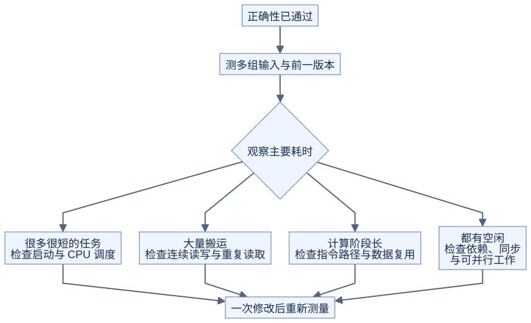

# 性能判断：先估算，再测量

**先问计算量和搬运量，再用实际测量判断主要限制。**

## 最简单的两项估算

```text
搬运时间估算 = 字节数 / 对应存储层的带宽
计算时间估算 = 运算数 / 对应精度与指令路径的计算速度
```

理想重叠下，两者中的较大值可作粗略时间下界。实际还会受到启动、同步、地址计算、缓存、依赖与资源利用的影响。这里的数据量与带宽必须属于同一存储层，不能把逻辑读写量直接当成实测显存流量。这样的上界分析称为 Roofline。[Nsight Compute Roofline](https://docs.nvidia.com/nsight-compute/ProfilingGuide/index.html#roofline-charts)

## 两个手算例子

| 计算 | 运算量 | 简化的逻辑读写量 |
| --- | --- | --- |
| FP32 向量相加，N 个元素 | N 次加法 | 读 A、B，写 C，共 12N 字节 |
| FP32 GEMM，C=A@B | 约 2MNK 次运算 | 理想地每个输入只读一次、输出只写一次：4(MK+KN+MN) 字节 |

GEMM 的式子是理想复用假设；真实 kernel 会重复读数据，缓存也会改变显存流量。两种式子均不含 CPU 与 GPU 之间的输入输出传输。

例如 `M=N=K=32`，约有 65536 次运算、12288 字节理想读写，即约 5.33 次运算/字节。它只是手算例子，不是 H20 性能结果。

## 由现象决定下一步



[图源](figures/performance-basics-01.mmd)

原理示意：这些是排查方向，不能仅凭算子名字确定瓶颈。

## 工具分别回答什么

| 工具 | 先用来回答 |
| --- | --- |
| CUDA Events | GPU 上这一段工作花了多久？ |
| Nsight Systems | CPU、拷贝、GPU 任务之间哪里在等待？ |
| Nsight Compute | 单个 kernel 的访存、计算和资源使用怎样？ |
| Compute Sanitizer | 是否存在越界、共享内存竞争等问题？ |

同一 stream 中记录开始 event、执行 kernel、记录结束 event，等待结束 event 后再读取耗时。编译和预热不计入稳定运行时间；小任务可重复执行后统计。具体测量要求见 [实验规范](README.md)。

Nsight Compute 采集可能通过重放执行来收集数据，因此分析报告中的运行条件不应直接代替独立 benchmark。[Nsight Compute Profiling Guide](https://docs.nvidia.com/nsight-compute/ProfilingGuide/index.html)

自测：kernel 时间变短，但先把输入转为连续布局花了很多时间，能否直接说整个算子变快？不能；还要比较包含这些必要操作的端到端时间。
