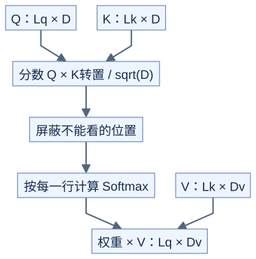

# 计算所需的数学：先知道每个结果从哪里来

**优化可以改变计算顺序与数据位置，但必须保留约定的数学含义。**

## 从逐元素计算到归约

```text
原理示意

逐元素相加：[1,2,3] + [4,5,6] → [5,7,9]   三个结果相互独立
归约求和： [1,2,3,4] → [3,7] → [10]       中间结果需要合并
```

归约只是在说“把一组数合成结果”，求和、最大值都是例子。归约轴是被合并的维度：对 `(2,3)` 矩阵按列方向求和，每行得到一个结果，共两个结果。

## GEMM 的 M、N、K

先学习 `C = A @ B`：

```text
原理示意

A：M 行 K 列       B：K 行 N 列       C：M 行 N 列
取第 i 行  ──┐   ┌── 取第 j 列
             └─ 对应相乘，再求和 ─→ C[i,j]

A = [1 2 3]       B = [1 0]         C = [ 4  5]
    [4 5 6]           [0 1]             [10 11]
                      [1 1]
```

公式是 `C[i,j] = sum(A[i,k] * B[k,j], k=0..K-1)`。M、N 决定输出大小，K 决定每个输出要合并多少项。通常按每次乘加算 2 次运算，用约 `2*M*N*K` 表示计算量。

更一般的 GEMM 还包括 `alpha*A@B + beta*C`。比较成熟库时，要确认缩放、转置和旧输出的处理都相同。逐步优化的代码阅读可参考作者维护的 [SGEMM_CUDA](https://github.com/siboehm/SGEMM_CUDA)，其性能数字不能直接当作 H20 结果。

## Softmax：把分数转换成权重

对一行分数 `x`：

```text
m = max(x)
e[j] = exp(x[j] - m)
p[j] = e[j] / sum(e)
```

减去最大值不改变数学结果，并避免直接计算很大的指数。例如 `[1000,1000]` 先变成 `[0,0]`，得到权重 `[0.5,0.5]`。

Softmax 包含求最大值、求和以及逐元素计算，这就是 Attention 之前先学归约的原因。

## Attention：两次矩阵乘法，中间算权重

暂时只看一个头、一次前向计算，不含 dropout：



[图源](figures/03-math-for-kernels-01.mmd)

原理示意：一行 Q 对所有 K 打分，再用这些权重合并 V。分数矩阵大小是 `Lq × Lk`；当两者都随序列增长时，中间存储增长很快。

causal Attention 在同长度自注意力中，只允许位置 i 看位置 `j <= i`。被屏蔽的位置在 Softmax 前设为负无穷。整行都被屏蔽时，需要单独规定输出，不能直接假设普通 Softmax 公式有效。FlashAttention 在保持精确 Attention 数学定义的前提下减少中间结果存储；不同浮点计算顺序仍可能产生小误差。[FlashAttention](https://github.com/dao-ailab/flash-attention)

## 自测

Q 为 `(4,8)`、K 为 `(6,8)`、V 为 `(6,3)`，分数与输出各多大？

<details>
<summary>参考答案</summary>

分数为 `(4,6)`，每行在 6 个位置上归一化；输出为 `(4,3)`。

</details>

下一篇：[浮点数与误差](04-floating-point.md)。
