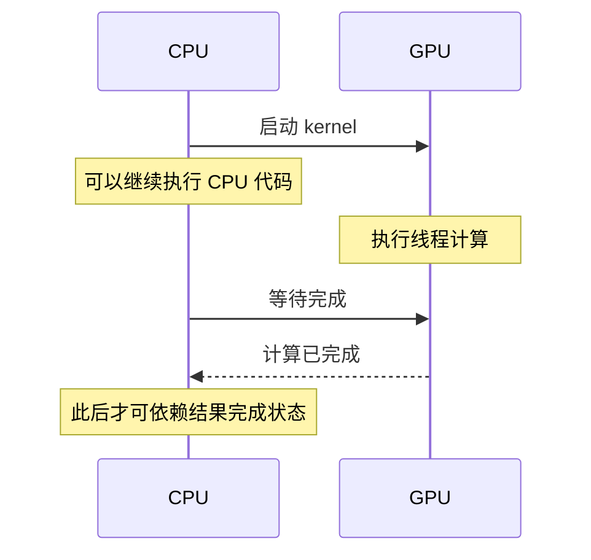

# 同步与异步：先明确在等谁

**发出任务、任务开始、任务完成，是三个不同时间点。**



原理示意。只在 CPU 上测“启动调用用了多久”，通常测不到完整的 GPU 计算时间。[NVIDIA 异步执行](https://docs.nvidia.com/cuda/cuda-programming-guide/02-basics/asynchronous-execution.html)

## 三种等待别混淆

| 范围 | 典型方式 | 解决的问题 |
| --- | --- | --- |
| 一个线程块 | `__syncthreads()` | 等块内线程把共享数据准备好 |
| 同一 GPU 的任务队列 | stream 顺序、event 依赖 | 后一个操作等待需要的前一个操作 |
| CPU 等待 GPU | `cudaStreamSynchronize` 等 | CPU 确认 GPU 工作已完成 |

stream 是按顺序安排 GPU 操作的队列。同一 stream 内操作有顺序，不同 stream 之间有数据依赖时需显式安排；不同 stream 也不保证真的并行执行。不要依赖默认 stream 的隐含行为来解释实验。[NVIDIA 异步执行](https://docs.nvidia.com/cuda/cuda-programming-guide/02-basics/asynchronous-execution.html)

## 块内共享数据的正确顺序

```text
原理示意：共享缓冲区被重复使用时

各线程写自己的位置 → 块内等待 → 读取别人写的数据
                                      ↓
下一轮覆盖同一缓冲区 ← 块内等待所有读取完成
```

把 `__syncthreads()` 放进只有部分线程进入的分支会破坏同步要求。处理尾部元素时，可以让无效位置写入中性值，再让块内线程共同走过同步点；不要直接把屏障包进 `if (i < n)`。屏障不能充当普通 grid 内所有块的集合点。[NVIDIA 线程同步说明](https://docs.nvidia.com/cuda/cuda-programming-guide/02-basics/writing-cuda-kernels.html)

## 同时写一个结果

两个线程都执行普通 `sum += x`，可能先读到相同旧值，再各自覆盖，导致丢失更新。`atomicAdd` 保证该地址的这次更新不可被同类操作拆开，但不代替整个块的同步，也不保证浮点累加顺序固定。

## 如何排查

启动后检查启动错误，在适当同步位置检查执行错误。Compute Sanitizer 的 `memcheck` 用于内存访问问题，`racecheck` 用于共享内存竞争，`synccheck` 用于同步用法；某项检查通过不等于数学结果正确。[Compute Sanitizer](https://docs.nvidia.com/compute-sanitizer/ComputeSanitizer/index.html)

自测：线程 0 在写完自己的共享数据后，能立即读取线程 31 的数据吗？如果尚无同步保证，不能。

下一篇：[性能判断](../methodology/performance-basics.md)。
