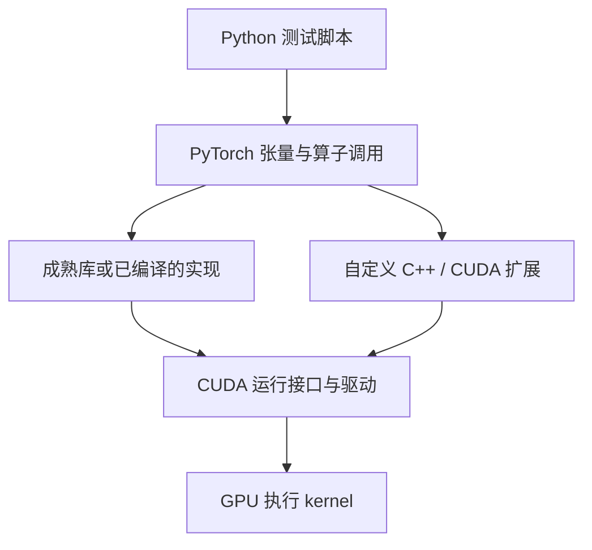
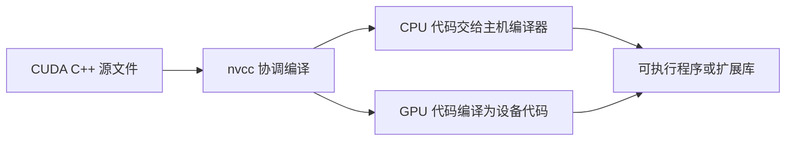

# 软件栈

**编译工具负责把代码变成可执行形式，运行库和驱动负责把工作交给 GPU。** 本页解释各层作用，实际环境版本尚待 H20 验证。

## 一次调用经过哪里

原理示意：调用 PyTorch 算子不等于现场编译一份 `.cu`；具体后端取决于算子和执行方式。

| 组件 | 作用 | 常见误解 |
| --- | --- | --- |
| NVIDIA 驱动 | 管理设备，加载并执行 GPU 代码 | 安装驱动不等于安装开发工具 |
| CUDA Toolkit | 提供编译器、头文件及开发库 | 不等于 PyTorch 的版本 |
| `nvcc` | 协调 CPU 与 GPU 代码编译 | 不是只处理 GPU 部分 |
| PyTorch | 管理张量并选择计算实现 | 能运行 PyTorch 不等于能编译自定义扩展 |
| CMake / Ninja | 组织并执行构建步骤 | 不负责决定 kernel 怎么优化 |

CUDA Runtime API 是常用的较高层接口，底层还有 Driver API。课程先用前者，读上游代码时再按需了解后者。[NVIDIA CUDA C++ 入门](https://docs.nvidia.com/cuda/cuda-programming-guide/02-basics/intro-to-cuda-cpp.html)

## 编译时发生什么

原理示意。PTX 是 GPU 的中间指令形式；最终执行的是面向具体设备的机器代码。构建产物可以包含设备机器代码及 PTX，驱动在适用情况下进一步编译 PTX。目标架构设置会影响代码是否能运行、能使用哪些特性，不能只改一个架构名字就假定移植完成。[NVIDIA NVCC 指南](https://docs.nvidia.com/cuda/cuda-programming-guide/02-basics/nvcc.html)

环境排查分别记录驱动版本、`nvcc --version`、PyTorch 版本及其 CUDA 构建版本。版本是否兼容应查对应兼容规则，不要求数字全部相等。[NVIDIA 兼容性文档](https://docs.nvidia.com/deploy/cuda-compatibility/latest/index.html)

## 进阶技术何时引入

| 技术 | 本课程用途 |
| --- | --- |
| CUDA C++ | 亲自安排线程、数据位置与同步 |
| cuBLAS / cuBLASLt | GEMM 性能与正确性的重要对照 |
| CUTLASS / CuTe | 学习可组合的矩阵计算实现和数据布局描述 |
| CuTe DSL | 阅读用 Python 语法表达的现代 GPU 实现 |
| Triton | 选定算子的另一种实现方式，用于对照 |

CUTLASS 上游同时提供 C++ 与 Python DSL 相关内容，阅读前要选择具体版本与入口。[NVIDIA CUTLASS](https://github.com/NVIDIA/cutlass)

自测：为什么系统可以运行预编译的 PyTorch 算子，却提示找不到 `nvcc`？运行已有代码与本机编译源码所需组件不同。
