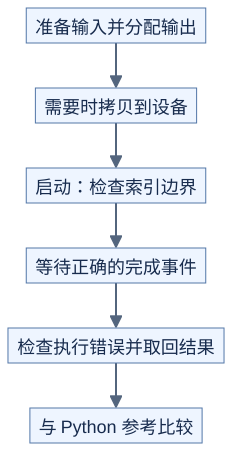

# 第一个算子：把 Python 循环分给线程

**一个线程处理哪个元素，由索引公式决定。** 前置：[Python 到 C++](../../docs/prerequisites/01-python-to-cpp.md)、[线程层次](../../docs/hardware/execution.md)。这里只推导连续一维数组相加，输入输出长度相同，输出独立存储。

## 1. 从一行 Python 开始

```python
y = [a + b for a, b in zip(x, z)]
```

假设每块 T=256 个线程，第 b 块内线程 t 处理 `i=b*T+t`。长度 N=1000 时启动 `ceil(1000/256)=4` 块，得到 1024 个线程；i>=1000 的 24 个线程不能读写数组。

```text
原理示意
块 0：元素   0..255
块 1：元素 256..511
块 2：元素 512..767
块 3：元素 768..999，剩余线程跳过读写
```

边界判断放在读取之前。此算子不需要线程间通信，因此没有块内等待；若后续改成需要同步的算法，不能机械照搬提前返回。

## 2. 线程也可以循环处理多个元素

总共启动 B 个块、每块 T 个线程时，令每线程从 `b*T+t` 开始，每次加 `B*T`，直到达到 N。这样每个有效位置仍恰好处理一次，且每一轮相邻线程访问相邻元素；这叫 grid-stride loop，即按整张线程网格的跨度循环。

N=0 时直接返回空输出，主机端无需启动零块 kernel。循环方案可以限制启动块数，但块数太少也会减少并行机会。

## 3. CPU 与 GPU 的执行顺序



[图源](figures/vector-add-01.mmd)

Python 框架可管理分配和部分依赖，底层步骤仍存在。主机发出 kernel 后通常可继续运行；读取结果或计时必须使用正确依赖。区分“启动参数错误”和“执行中错误”，前者检查启动返回状态，后者可能在等待时才报告。[CUDA 异步执行](https://docs.nvidia.com/cuda/cuda-programming-guide/02-basics/asynchronous-execution.html)

## 4. 从最小算子学会估算

每元素读 x、z 各一次，写 y 一次。FP32 逻辑流量为 `12*N` 字节，运算量为 N 次加法。这个比例提示应重视读写，但短数组还可能主要花在启动上。它不需要共享内存，因为没有跨线程复用输入。

CPU 检查不能证明 GPU 没有越界。设备到位后还要检查不同长度、输入类型、非连续输入支持范围和错误返回，并测量“仅 kernel”与“含拷贝”两种时间。

## 自测与验证

N=9、T=4，常规启动几块？循环版本若只启动两块，谁处理元素 8？

<details>
<summary>答案</summary>

常规启动 3 块；两块循环方案中，第 0 块第 0 线程先处理 0，再处理 8。输出每个元素只能被写一次。

</details>

运行 [check_launch_and_schedule.py](../../tools/check_launch_and_schedule.py)，检查空数组、尾部和循环覆盖。这是 CPU 索引演示，不是 CUDA 实现。
