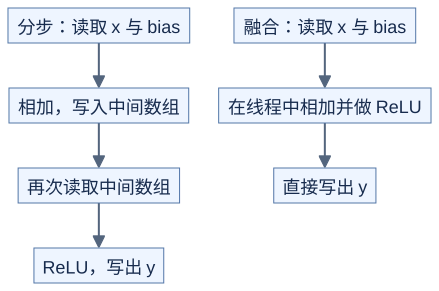

# 融合：明确省掉了哪个中间数组

**先画出中间结果的读写，再决定哪些步骤放在一起。** 前置：[归一化](normalization.md)、[数据量估算](../../docs/methodology/performance-basics.md)。以下以有限输入为前提，读写量均是逻辑元素数，不是显存实际传输量。

## 1. 从 bias + ReLU 开始

对 M×D 的 x 和长度 D 的 bias，`y[i,j]=max(x[i,j]+bias[j],0)`：



[图源](figures/fusion-01.mmd)

| 方式 | x | bias | 中间数组 | y | 合计 |
| --- | --- | --- | --- | --- | --- |
| 分两步 | 读 MD | 读 MD | 写 MD + 读 MD | 写 MD | 6MD |
| 融合 | 读 MD | 读 MD | 无 | 写 MD | 4MD |

这里把每个输出对 bias 的逻辑访问都计入；缓存可能复用它。若每元素 b 字节，减少的中间读写是 `2MDb` 字节。比值 6/4 不是加速比：实际还受缓存、启动和指令成本影响。

## 2. 加上残差和 RMSNorm，就有跨元素依赖

残差相加指把同形状的两份输入相加：`u=x+r`，然后 `y=RMSNorm(u)`。与逐元素 ReLU 不同，y 的每个值都依赖整行 u 的平方和。

```text
原理示意

x、r → 每线程算自己的 u → 全行合并平方和 → 用统计量变换 u → y
                            所有 u 都影响分母
```

假设中间 u 不需要返回，gamma 按每输出一次逻辑读取计，统计量开销忽略，三种教学方案为：

| 方案 | 逻辑访问量 | 主要代价 |
| --- | --- | --- |
| 分步：写 u，RMSNorm 两遍读 u | 读 x/r 2MD + 写 u MD + 读 u 2MD + 读 gamma MD + 写 y MD = 7MD | 保存中间数组 |
| 融合并保留 u | 读 x/r 2MD + 读 gamma MD + 写 y MD = 4MD | 寄存器长时间保留 u |
| 融合但重新计算 u | 两次读 x/r 4MD + 读 gamma MD + 写 y MD = 6MD | 重复相加与读取 |

分步 RMSNorm 如果自己保留 u，只读一遍 u，合计会变为 6MD；公平比较应写明采用哪个基线。若调用方还需要返回 u，融合版本必须把 u 写出，不能把必要输出算作可省掉的中间结果。

## 3. 融合也可能改变数值

若分步版本把 u 存成 FP32，它会先舍入；融合后若保留更高精度的 u，输出可能变化。验证约定必须明确在哪一步转为哪个精度。

```text
可复现的小例子（bias + ReLU）
x=16,777,216，bias=1

相加后存 FP32：16,777,216
双精度保留相加结果：16,777,217
```

这不是 CUDA 加速结论，而是一次舍入的例子。若最终输出也转 FP32，此例的差异又会消失；多个后续操作时不能假定总会消失。配套演示同时检查“保留相同舍入步骤”的分步与融合版本。

## 4. 什么时候先不融合

当两个阶段需要完全不同的线程分工、整行保留导致资源过大，或者中间结果被多个后续操作使用时，先保留分步版更容易比较。融合候选应同时记录：省下的数组、新增的等待、每线程保留的值，以及实际所需输出。

自测：要求同时返回 u 和 y，保留 u 的融合方案逻辑访问量是多少？

<details>
<summary>答案</summary>

由 4MD 变成 5MD，多一次 u 的写入。仍可避免从显存重新读取 u，但不能删掉返回值。

</details>

运行 [check_classic_operators.py](../../tools/check_classic_operators.py)，验证分步、保留中间值和重算三种方式，以及显式 FP32 舍入。脚本不测 GPU 时间。
