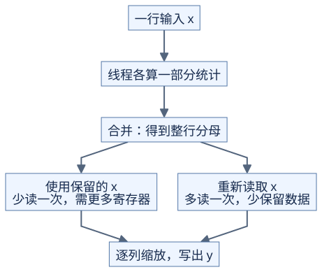

# LayerNorm 与 RMSNorm：先统计，再写结果

**行统计量没算完，就不能确定这一行的最终输出。** 前置：[归约](reduction-and-scan.md)、[浮点误差](../../docs/prerequisites/04-floating-point.md)。本页输入为多行数据，每行 D>0 个有限数，最后一维归一化；gamma、beta 各有 D 个元素。

## 1. 手算一行，固定数学定义

取 x=[1,3]、gamma=[1,1]、beta=[0,0]。为便于手算，这个例子使用 epsilon=1；代码练习使用 1e-5。

| 步骤 | LayerNorm | RMSNorm |
| --- | --- | --- |
| 行统计 | 均值 2，方差 1 | 平方均值 5 |
| 分母 | sqrt(1+1) | sqrt(5+1) |
| 输出 | [-1,1]/sqrt(2) | [1,3]/sqrt(6) |

LayerNorm 的方差除以 D，不是 D-1；RMSNorm 不减均值。本课显式传入正的 epsilon，放在平方根内部，并使用可学习的逐列 gamma；LayerNorm 还加 beta。与库比较时也要显式指定参数，尤其不能假定 RMSNorm 默认 epsilon 永远是 1e-5。[PyTorch LayerNorm](https://docs.pytorch.org/docs/2.14/generated/torch.nn.LayerNorm.html)、[RMSNorm](https://docs.pytorch.org/docs/2.14/generated/torch.nn.RMSNorm.html)



[图源](figures/normalization-01.mmd)

## 2. 先写容易检查的版本

LayerNorm 分三次遍历 x：求均值；求 `(x-mean)^2` 的平均；再次读取 x 写输出。RMSNorm 只需平方和与输出两遍。两者都能用高精度参考检查。

这里说的是遍历次数，不等于 kernel 数量：一个块内也能多次遍历。若每个阶段单独启动 kernel，则需要把统计量保存到中间数组。CPU 演示分开计算统计和输出，使依赖可见。

## 3. 把一行交给一个线程块

线程 t 处理 `t, t+T, t+2T, ...` 列，T 为块内线程数。各线程先求局部统计，再合并。无效列不加入样本数；若 D=33，不能把补到 64 的位置当作 64 个样本算平均。

| 输入处理方式 | 减少了什么 | 付出什么 |
| --- | --- | --- |
| 统计后重新读取 x | 不必长时间保留整行 | 多一次或多次读取 |
| 在线程寄存器里保留自己负责的 x | 可以只读一次 x | 每线程大约多保留 ceil(D/T) 个值 |
| 一行分给多个块 | 给很长的行更多并行机会 | 需要合并统计，再安排输出 |

保留 x 的同时还有平方和、地址、gamma 等临时值。源码数组不保证全进寄存器；编译后要检查实际资源与局部内存读写。选择应结合[资源预算](../../docs/hardware/resource-budget.md)和行数：只有很少的行时，一行一个块也可能分不满设备。

## 4. LayerNorm 怎样稳定地合并统计

直接用 `mean(x²)-mean(x)²` 会相减两个很接近的大数。教学参考采用两遍中心化计算；需要分块合并时，可保存 `(n, mean, M2)`，其中 M2 是相对均值的平方差之和。

<details>
<summary>两个小组的合并公式与手算</summary>

令两组为 a、b，`delta=mean_b-mean_a`：

```text
n    = n_a + n_b
mean = mean_a + delta*n_b/n
M2   = M2_a + M2_b + delta²*n_a*n_b/n
variance = M2/n
```

空组直接返回另一组，避免除零。第三项补回两组均值不同产生的差异。

例如 [1,3] 的状态为 (2,2,2)，[5] 为 (1,5,0)。合并后均值 3，M2=2+0+9×2/3=8，方差 8/3，与直接对 [1,3,5] 计算一致。这类更新通常称为 Welford 统计；本课只需理解“数量、均值、平方差和”三个量。

</details>

RMSNorm 合并各组平方和与有效元素数即可，不使用上面的中心化方差。数学稳定也不意味着任意大输入都安全：有限精度中平方仍可能溢出；CPU 双精度验证不能替代实际 FP32/低精度范围测试。

## 5. 验证哪些情况

- 常数行、全零行、D=1：LayerNorm 输出应为 beta；RMSNorm 全零输出为零。
- D 不是块宽整数倍：统计数量仍为 D。
- 大公共偏移加小差值：检查方差是否保留小差异。
- 非均匀 gamma、非零 beta：防止漏掉逐列参数。

运行 [check_classic_operators.py](../../tools/check_classic_operators.py)。它用独立的 Decimal 高精度参考检查两遍计算与分组合并，同时演示相近大数相减造成的方差错误。

自测：RMSNorm 能直接复用 LayerNorm 的方差吗？

<details>
<summary>答案</summary>

不能。平方均值与中心化方差相差均值的平方。常数非零行的方差为零，平方均值却不为零。

</details>
