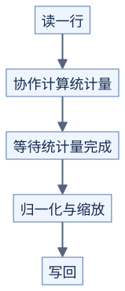

# 经典算子：先识别重复出现的计算方式

前置：[归约与数学](../../docs/prerequisites/03-math-for-kernels.md)、[线程协作](../../docs/prerequisites/05-synchronization.md)。本页用原理说明方向，完整实现与性能待验证。

## 归约：各算一部分，再合并

```text
原理示意：求和

[1] [2] [3] [4] [5] [6] [7] [8]
 └─3─┘   └─7─┘   └─11┘   └─15┘
    └──10──┘        └──26──┘
           └────36────┘
```

线程先各自计算局部和，再在小范围合并，最后得到块内结果。数据很大时，可先让多个块输出局部结果，再用下一次计算合并。每一步都要明确参与线程和同步范围；改变分组也会改变浮点加法顺序。

越界位置的“中性值”随运算变化：求和用 0，求最大值常用负无穷。只靠 `atomicAdd` 累加所有输入虽然易写，但大量线程争用同一位置可能成为限制。

## 前缀和：需要所有中间结果

```text
原理示意

输入             [1, 2, 3, 4]
包含当前位置的和 [1, 3, 6,10]
不含当前位置的和 [0, 1, 3, 6]
```

它与归约不同：不能只留下最终总和。分块处理时，每块先求自己的前缀，再把前面所有块的总和加进来。后续可用于筛选有效元素后，为输出位置编号。

## LayerNorm 与 RMSNorm

以下公式作用于长度为 D 的一行，epsilon 是避免分母过小的正数：

```text
LayerNorm:
  mean = sum(x)/D
  variance = sum((x-mean)^2)/D
  y = (x-mean)/sqrt(variance+epsilon) * gamma + beta

RMSNorm:
  mean_square = sum(x^2)/D
  y = x/sqrt(mean_square+epsilon) * gamma
```

公式对应 [PyTorch LayerNorm](https://docs.pytorch.org/docs/main/generated/torch.nn.LayerNorm.html) 和 [PyTorch RMSNorm](https://docs.pytorch.org/docs/main/generated/torch.nn.RMSNorm.html) 的常见形式。

两者都先求行统计量，再逐元素变换。短行可以尝试让线程保留输入，减少第二次读取；长行若全部保留，会增加寄存器压力。LayerNorm 用 `mean(x^2)-mean(x)^2` 计算方差可能因相近大数相减丢失精度，不能只看计算步骤变少。



[图源](figures/operator-patterns-01.mmd)

原理示意。要先定义归一化的轴、累加精度、epsilon 位置以及是否有偏置，再比较结果。

## 融合：中间结果可以不落到显存吗

比如 `z = activation(x + bias)`，分成两个 kernel 时通常要保存并读取中间相加结果。融合后可在线程内完成两步，再写 z。

但把更多工作放在一起也可能增加寄存器和同步负担；不同操作的最佳线程分工也可能不同。融合是需要验证的选择，而非必然加速。

代码选读：[NVIDIA CUDA Samples](https://github.com/NVIDIA/cuda-samples) 的并行计算示例，以及 [llm.c](https://github.com/karpathy/llm.c) 的算子实现。浮点与归约顺序见 [NVIDIA 浮点说明](https://docs.nvidia.com/cuda/floating-point/index.html)。

## 自测

求最大值时，输入全是负数，尾部补 0 会怎样？会把不存在的 0 当作最大值。这说明尾部处理必须跟随数学定义。
