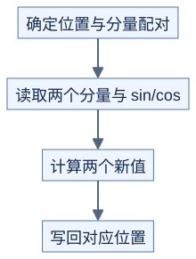

# RoPE：对两个分量做一次旋转

**位置改变旋转角度，旋转后的 Q、K 再参与注意力打分。** 前置：[Attention 数学](../../docs/prerequisites/03-math-for-kernels.md)。

## 先看二维

```text
原理示意：角度 theta=90 度

          y
          ↑   (0,1) 旋转后
          │    ↑
          └────●────→ x
              (1,0) 旋转前
```

对一对分量 `(a,b)`：

```text
a_new = a*cos(theta) - b*sin(theta)
b_new = a*sin(theta) + b*cos(theta)
```

在精确数学下，`a_new^2+b_new^2=a^2+b^2`。RoPE 给不同位置与不同分量对使用对应角度；Q、K 旋转后的内积可以体现相对位置。[RoFormer 原论文](https://arxiv.org/abs/2104.09864)

## 配对方式必须一致

```text
原理示意：四个分量的两种常见存储约定

相邻配对：(x0,x1) 与 (x2,x3)
前后半配对：(x0,x2) 与 (x1,x3)
```

两种排列不是直接可互换的输入接口。要同时对齐 Q/K 的排列、sin/cos 的索引、实际旋转维度和位置编号；部分维度不参与旋转时保持原值。

## 优化首先看搬运

每对输入只需少量乘加。可以让同一线程持有一对分量，复用 sin/cos，或者与前面的归一化结合。但若配对元素在内存中相隔很远，线程分工就需要重新设计。



[图源](figures/rope-01.mmd)

原理示意。原地更新时，要先读取这一对的两个旧值，再写新值，防止第二个计算误用已更新的第一个值。

自测：把 `(1,0)` 旋转 90 度得到什么？再转回去呢？分别为 `(0,1)` 和 `(1,0)`，浮点计算可能有极小误差。
