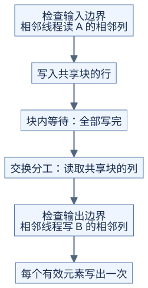

# 矩阵转置：先改变地址，再改变存储方式

**结果不变，优化的是同一批线程读写的地址。** 前置：[张量索引](../../docs/prerequisites/02-tensors-and-layout.md)、[线程布局](../03-gemm/03-thread-layout.md)。本页限定输入输出分开存储，二维行优先矩阵；不讨论原地转置。

## 1. 从能算对开始

```text
原理示意：A 为 2×3，B 为 3×2

A             B
0 1 2         0 3
3 4 5         1 4
              2 5

B[col, row] = A[row, col]
```

A 有 M 行、N 列且连续时，源地址是 `row*N+col`，目标地址是 `col*M+row`。让相邻线程处理同一行的相邻 col，源地址连续，目标地址却相隔 M 个元素。若实际每行带有填充，应分别使用 A、B 的行步长，不能直接用 N、M。

## 2. 用共享内存交换分工



[图源](figures/transpose-01.mmd)

对 32×32 数据块，可以用 32×8 个线程，每线程处理 4 个元素。设块的输入起点为 `(r0,c0)`，线程坐标为 `(tx,ty)`：

| 阶段 | 对 j=0、8、16、24 执行 |
| --- | --- |
| 读取 | `tile[ty+j,tx] = A[r0+ty+j,c0+tx]` |
| 等待 | 块内所有线程完成共享内存写入 |
| 写出 | `B[c0+ty+j,r0+tx] = tile[tx,ty+j]` |

两次访问里 tx 都对应全局内存的连续列，但读和写不再由同一个线程负责同一个元素。共享块的坐标和输出块的坐标都要交换。NVIDIA 的转置教程展示了这种方式；其中旧 GPU 的性能数字不用于推断 H20。[官方转置教程](https://developer.nvidia.com/blog/efficient-matrix-transpose-cuda-cc/)

## 3. 为什么多放一列

对 32 位元素，用简化映射 `bank = 元素地址 % 32` 理解共享内存的 32 个 bank（可并行访问的存储分组）。读同一列 c、让线程 t 取第 t 行时：

```text
行宽 32：bank(t,c) = (32*t+c)%32 = c       挤到同一组
行宽 33：bank(t,c) = (33*t+c)%32 = (t+c)%32 分散到 32 组
```

于是声明 32×33 的共享块，但只保存 32×32 的有效数据。多出的列改变行间距。这个推导限定为各线程读不同地址的 32 位元素；不同数据宽度、广播和向量指令应重新分析，不能机械地“都加一列”。[CUDA 共享内存说明](https://docs.nvidia.com/cuda/cuda-c-best-practices-guide/index.html#shared-memory)

## 4. 尾块最容易错在哪里

输入读取条件：`r0+ty+j<M 且 c0+tx<N`。输出写入条件：`c0+ty+j<N 且 r0+tx<M`。两者对应不同元素，不能复用某个线程自己的读取条件。

线程即使没有有效输入，也要参加中间的块内等待。先让部分线程返回再让其余线程等待，可能破坏同步要求。合法输出只读取已经装入共享块的元素；配套 CPU 演示用未初始化标记检查这一点。

## 5. 每版改变了什么

| 版本 | 改动 | 新代价/检查 |
| --- | --- | --- |
| 直接转置 | 直接交换目标坐标 | 输出访问不连续 |
| 共享块 | 交换读写分工 | 共享内存、块内同步、两套边界条件 |
| 共享块加一列 | 分散列读取的 bank | 多一点共享内存，核对元素宽度 |

三版逻辑上都只需读、写各 M×N 个元素；改进来自实际访问效率，不是公式里的字节数减少。

自测：输入 3×5，输出的行步长能继续用 5 吗？

<details>
<summary>答案</summary>

连续输出是 5×3，行步长为 3。如果输出另有填充，则用输出自己的实际步长。

</details>

运行 [check_classic_operators.py](../../tools/check_classic_operators.py)：验证矩形、尾块、带填充行步长和两种共享布局。它把线程及每线程循环展开为共享块的行列遍历，按阶段模拟索引，不模拟 CUDA 线程调度。
