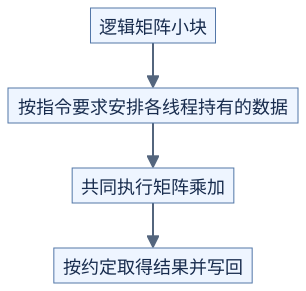
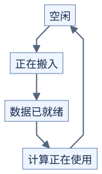

# Tensor Core 与流水线：把计算和搬运安排好

前置：[GEMM 分块](01-tiling.md)、[同步与异步](../../docs/prerequisites/05-synchronization.md)。

## Tensor Core 接收一小块矩阵运算

**它不是把普通乘法换个函数名，而是要求线程按约定组织数据。**



[图源](figures/02-tensor-core-and-pipeline-01.mmd)

原理示意。矩阵乘加常写作 `D = A*B + C`，MMA 就是这个操作的简称。支持的矩阵形状、数据类型、存储位置和参与线程范围取决于具体指令；CuTe 用布局描述这些对应关系。[CuTe 矩阵乘加说明](https://docs.nvidia.com/cutlass/latest/media/docs/cpp/cute/0t_mma_atom.html)

因此，阅读一个实现先找四件事：输入在何处、哪些线程参与、累加结果放在哪里、何时允许读取结果。不要把普通线程的 `2×2` 结果分配图套到所有 Tensor Core 指令上。

## 两个缓冲区交替使用

假设搬一块耗时 L，算一块耗时 C，连续执行 P 块。顺序执行大致要 `P*(L+C)`。如果硬件和依赖允许完美重叠，理想时间为 `L+C+(P-1)*max(L,C)`。

```text
原理示意：L=C，只画三块，不是硬件实测时间线

时间段       0       1       2       3
搬运      [搬块0] [搬块1] [搬块2]
计算              [算块0] [算块1] [算块2]
缓冲区      A       B       A
```

第三次搬运覆盖缓冲区 A 前，必须确定块 0 已不再使用它。计算块 1 前，必须确定搬运块 1 已完成。

## 每个缓冲区都有使用顺序



[图源](figures/02-tensor-core-and-pipeline-02.mmd)

原理示意。“可以写入”和“可以读取”是两种不同的等待。异步搬运和矩阵计算还需遵守对应操作的完成规则，不能仅凭一次普通块内屏障推断所有异步工作已完成。[CUTLASS 同步与流水线](https://docs.nvidia.com/cutlass/latest/media/docs/cpp/pipeline.html)

更多缓冲区可能覆盖更长等待，但消耗更多共享内存。流水线也有开始装填和最后收尾的成本，小矩阵不一定获益。

## 为什么一个配置不能覆盖所有矩阵

| 输入特点 | 可以考虑 | 代价 |
| --- | --- | --- |
| M、N 较大 | 较大的输出分块，增加复用 | 寄存器与共享内存更多 |
| M、N 很小，K 很长 | 把 K 分给多个块，最后合并，即 split-K | 额外中间结果、合并和舍入变化 |
| 大量尺寸不同的小 GEMM | 集中调度，即 grouped GEMM | 调度与边界更复杂 |

这些是选择方向，不是默认最优策略。手工减少启动或长期复用线程块也可能改变负载分配，需要后续设备测量。[CUTLASS GEMM 优化](https://docs.nvidia.com/cutlass/latest/media/docs/cpp/efficient_gemm.html)

## 自测

搬一块 2 个时间单位、算一块 5 个时间单位，共 4 块，顺序时间和理想重叠时间分别多少？

<details>
<summary>参考答案</summary>

顺序 `4*(2+5)=28`；理想重叠 `2+5+3*5=22`。这些单位是教学假设，不是 H20 延迟；同步和资源争用会让真实时间不同。

</details>
