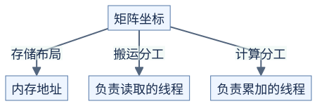

# 线程与矩阵元素：分清三种对应关系

**矩阵元素在哪里、谁去搬、谁去算，是三个不同问题。** 前置：[张量步长](../../docs/prerequisites/02-tensors-and-layout.md)与[GEMM 分块](01-tiling.md)。



[图源](figures/03-thread-layout-01.mmd)

原理示意。一个线程可以搬运自己不负责计算的数据；进入共享内存后，其他线程可以使用它。

## 二维线程块怎样组成 warp

线程块内先增加 x，再增加 y：`tid = x + blockDim.x*y`。以 `blockDim=(16,4)` 为例：

```text
原理示意：格内为线程编号

y=0  00 01 ... 15  ┐ warp 0
y=1  16 17 ... 31  ┘
y=2  32 33 ... 47  ┐ warp 1
y=3  48 49 ... 63  ┘
```

所以一行 16 个线程不等于一个 warp。检查连续读写时，要列出实际同一个 warp 的地址，而不是只看图上一行。[NVIDIA 线程层次](https://docs.nvidia.com/cuda/cuda-programming-guide/02-basics/writing-cuda-kernels.html)

## 让 32 个线程搬 64 个元素

对于连续的 `8×8` 数据块，可以让每个线程处理 `t` 和 `t+32`：

```text
第 1 次读取：线程 0..31 → 元素 0..31
第 2 次读取：线程 0..31 → 元素 32..63

元素 p 的坐标：row=p//8，col=p%8
```

这只是搬运分工。算 GEMM 时，可重新分配输出，例如让一个线程累加相邻的四个输出。读取方式不必跟输出责任绑定。

## 为什么转置需要换一种取法

对输入 A 的 `32×32` 小块，读取 `A[row, col]` 时，让相邻线程对应相邻 col。直接写 `B[col,row]` 时，地址就会相隔一整行。

共享内存提供交换位置的机会：

```text
原理示意

连续读 A 的行 → 写入共享块 → 等待 → 从共享块的列取值 → 连续写 B 的行
```

输入与输出的数据块坐标也要交换。共享块常额外加一列减少特定列读取的 bank 冲突，见[存储说明](../../docs/hardware/memory.md)。边界处既要保护输入读取，也要保护转置后的输出写入。

## CuTe 的 Layout 先当作坐标函数理解

最简单的布局把 `(row,col)` 变成 `row*row_stride + col*col_stride`。CuTe 还能用嵌套形状表达分组，把大块继续拆成小块；初学时先对一个小尺寸打印坐标和偏移，别一上来展开所有模板。[CuTe Layouts](https://docs.nvidia.com/cutlass/latest/media/docs/cpp/cute/01_layout.html)

这种存储布局与 Tensor Core 指令要求的线程/元素对应关系相关，但不是同一个概念。读取源码时要确认某个 layout 描述的是内存，还是线程持有的值。

## 自测

`blockDim=(16,4)`，`threadIdx=(3,2)` 属于哪个 warp、哪个位置？

<details>
<summary>参考答案</summary>

tid=35，warp 编号 `35//32=1`，warp 内位置 `35%32=3`。

</details>
