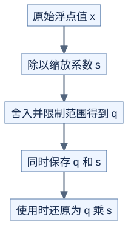

# 低精度计算：数值与缩放要一起看

**减少存储位数通常会损失信息，缩放只帮助利用有限范围。** 前置：[浮点误差](../../docs/prerequisites/04-floating-point.md)。

## 先用整数例子认识缩放

用范围为 `[-127,127]` 的整数表示浮点数，本页约定 s 是还原时乘的系数：

```text
s = max(abs(x)) / 127       全零输入时约定 s=1
q = clip(round(x/s), -127, 127)
x_approx = q*s
```



[图源](figures/04-low-precision-01.mmd)

原理示意。假设范围暂时缩小为 `[-7,7]`，输入 `[0,1,7]` 得到 s=1，可以精确表示；输入 `[0,1,70]` 得到 s=10，1 会舍入到 0。这说明同一组里的大值会影响小值的分辨率。

## 每组使用自己的缩放

```text
原理示意

整行一组：[0.1, 0.2, 100, 200] → 一个 s
两小组：  [0.1, 0.2] [100, 200] → s0 与 s1
```

更细分组能适应局部范围，但需要更多缩放数据、计算与布局处理。FP8 是浮点格式而非上述整数格式，不能拿整数舍入代码模拟 FP8 的全部误差；它也有不同格式和缩放粒度。[NVIDIA Transformer Engine FP8/FP4 说明](https://docs.nvidia.com/deeplearning/transformer-engine-releases/release-2.13/user-guide/examples/fp8_primer.html)

## 缩放在 GEMM 的哪个位置

若整张 A、B 各只有一个还原系数：

```text
A ≈ sA*qA，B ≈ sB*qB
A@B ≈ (sA*sB)*(qA@qB)
```

若 K 方向不同块各有自己的缩放：

```text
C ≈ sum_g (sA[g]*sB[g]) * (qA_g @ qB_g)
```

每个局部乘积必须使用对应的系数，不能把所有未缩放乘积加完，再乘任意一个系数。还要看系数是否随行列变化；上式为简化的分块例子。

不同库可能把 `scale` 定义为量化时乘的数，即本页 s 的倒数。阅读接口先找量化/还原公式，不能凭变量名判断。NVIDIA 的分块 FP8 文档有明确的量化系数定义。[FP8 Blockwise Scaling](https://docs.nvidia.com/deeplearning/transformer-engine/features/low_precision_training/fp8_blockwise_scaling/fp8_blockwise_scaling.html)

## 公平比较需要什么

| 项目 | 为什么需要 |
| --- | --- |
| 高精度原输入 | 判断量化损失，而非仅验证低精度乘法 |
| 已量化输入的高精度参考 | 区分转换误差与 kernel 实现错误 |
| 缩放、转置、格式转换耗时 | 判断端到端收益 |
| 输入、乘法、累加、输出类型 | 输出是 FP32 不代表全程按 FP32 运算 |

自测：两个 K 分块的局部乘积都是 1，缩放乘积分别为 2 和 3，正确结果是多少？答案是 5；先求和再乘 2 会错成 4。
