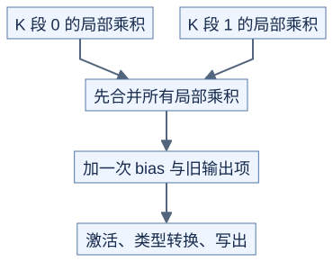

# GEMM 调度与最后的输出处理

**局部计算正确，还要保证任务不漏不重、结果只处理一次。** 前置：[分块](01-tiling.md)、[资源预算](../../docs/hardware/resource-budget.md)、[融合](../02-hardware-and-profiling/fusion.md)。本页先用普通二维矩阵说明，不涉及稀疏矩阵或多 GPU 通信。

## 1. 每个输出块是一项任务

对 M×N 输出、BM×BN 分块，先列出所有 `(块行,块列)`。普通启动可让一个 CUDA 块处理一项任务；另一种方法让较少的块循环领取多项任务，通常称为 persistent 调度，即让块持续工作。

```text
原理示意：任务 0..7，三个工作块
固定轮转：块0 → 0,3,6；块1 → 1,4,7；块2 → 2,5
动态领取：谁空闲谁取下一项，需要共享计数或调度协议
```

固定轮转易验证，却可能被长任务拖慢；动态领取更灵活，但有调度成本。CUDA 不保证块按编号依次执行，因此任务依赖不能建立在启动顺序上。集中处理多个不同形状的 GEMM 时，任务还要携带矩阵编号与偏移。[CUTLASS GEMM 组织](https://docs.nvidia.com/cutlass/latest/media/docs/cpp/efficient_gemm.html)

## 2. split-K：先相加，再做非线性操作

若 M、N 很小而 K 很长，可沿 K 切成多段：

```text
C_partial[s] = A[:, Ks] @ B[Ks, :]
C = sum_s C_partial[s]
Y = activation(alpha*C + beta*C_old + bias)
```



[图源](figures/05-schedule-01.mmd)

若有 S 段，朴素方案多保存 S×M×N 个累加元素，再读回来归约。原子累加可以改变这个存储选择，但需要正确初始化、同步、累加精度和输出处理协议。

bias 与 beta*C_old 只能加一次，activation 一般不能提前到每段：例如两段乘积为 -2 和 3，`ReLU(-2+3)=1`，而 `ReLU(-2)+ReLU(3)=3`。

## 3. 输出处理为什么也是优化对象

矩阵硬件产出的片段布局不一定适合连续写回。最后可能需要线程间交换或经过共享内存，再做缩放、bias、类型转换和写出。这一段常叫 epilogue，即主计算后的输出处理。

如果 C 的行列越界，既要避免非法写出，也要保护 bias、C_old 等输入读取。若 beta=0，算法可选择不读 C_old，但要按照接口定义确认，而不是读到 NaN 后再乘零。

## 4. 多个小矩阵怎样组织

grouped GEMM 为一组矩阵共享调度入口，但每个任务仍有自己的 M、N、K、步长和输出范围。统一分块可能浪费尾部；按尺寸分组又会增加准备成本。比较时要包含任务表准备、必要转换和输出合并，不能只看主循环。

无 GPU 时先检查：每项任务只完成一次、所有有效输出覆盖、不同矩阵的地址范围不重叠；有 GPU 后再判断调度是否减少空闲。

## 自测与验证

两段局部乘积为 4 和 5，bias=2，最终不加激活。每段先加 bias 再合并会得到多少？

<details>
<summary>答案</summary>

错误结果是 13，正确结果是 11。线性缩放可在满足精度约定时移动位置，但常数项不能重复加入。

</details>

[check_launch_and_schedule.py](../../tools/check_launch_and_schedule.py) 验证任务覆盖、不同大小矩阵的 split-K、尾段，以及 bias/激活只应用一次。
