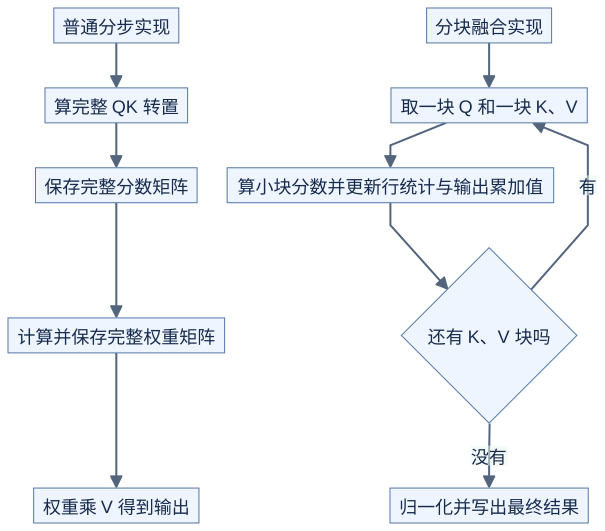

# Attention 分块融合：不保存完整的分数矩阵

前置：[逐块 Softmax](01-online-softmax.md)、[GEMM 分块](../03-gemm/01-tiling.md)。先讨论一个头、有限输入、无 dropout 的前向计算。

## 中间数据去了哪里



[图源](figures/02-tiled-attention-01.mmd)

原理示意：小块分数仍需计算，只是不必把完整分数与权重写到显存。FlashAttention 的关键是减少中间数据的显存读写，标准稠密 Attention 的计算量仍随序列长度近似平方增长。[FlashAttention 论文](https://arxiv.org/abs/2205.14135)

## 每个查询行维护什么

沿用 `m、l`，再增加一个向量 `u`，表示尚未除以分母的加权和。它的长度与 V 的一行相同。

新块分数为 s，对应值向量为 v：

```text
m_new = max(m_old, max(s))
alpha = exp(m_old - m_new)
w[j] = exp(s[j] - m_new)
l_new = alpha*l_old + sum(w)
u_new = alpha*u_old + sum(w[j]*v[j])

所有有效块处理完：output = u/l
```

这是逐块合并的教学写法。首次遇到有效块直接初始化 m、l、u，避免对两个负无穷做减法；后续块沿同样规则合并。[FlashAttention 算法](https://arxiv.org/html/2205.14135)

## 接着上一章手算

仍用分数 `[0,ln(2),ln(4)]`，对应标量 V 为 `[1,3,5]`：

| 步骤 | l | u |
| --- | --- | --- |
| 第一块 | 3/2 | (1/2)×1 + 1×3 = 7/2 |
| 第二块，旧结果乘 1/2 | 7/4 | (1/2)×(7/2) + 1×5 = 27/4 |

最终输出 `u/l=27/7`，与直接计算 `(1×1 + 2×3 + 4×5)/7` 一样。实际 V 是向量时，对每个分量做同样更新。

## 省下多大一块存储

一个头，查询和键长度都为 4096，仅一个 FP16 分数矩阵就需要：

```text
4096 × 4096 × 2 字节 = 32 MiB
```

这只是某种分步实现的一张中间矩阵大小；是否同时保存分数与权重、是否用 FP32 都取决于实现。分块融合仍需 Q、K、V、输出和小块临时空间，不是零显存开销。

## 掩码和尾部

```text
原理示意：同长度 causal 自注意力，✓ 表示可看

        K0 K1 K2 K3
Q0      ✓  ·  ·  ·
Q1      ✓  ✓  ·  ·
Q2      ✓  ✓  ✓  ·
Q3      ✓  ✓  ✓  ✓
```

完全被屏蔽的块可以跳过；部分有效的块只让有效分数参与。不能把不存在的键的分数补成 0，因为 `exp(0)` 会占据权重。整行无有效键时，本课程的 CPU 演示约定输出零，实际接入库时要对齐其接口约定。

不同查询长度和键长度下，causal 掩码可能涉及位置偏移；不能只凭局部行列号推断。GQA 还需明确哪些查询头共享哪组 K、V。

## 算法正确之后，还要安排线程

| 阅读阶段 | 重点问题 |
| --- | --- |
| 基础分块 | 如何不保存完整中间矩阵？ |
| FlashAttention-2 | 工作如何分给块与 warp，减少不必要的协作？ |
| FlashAttention-3 | Hopper 上如何重叠搬运、矩阵计算与其他计算？ |

后两项分别参考作者的 [FlashAttention-2 论文](https://arxiv.org/abs/2307.08691) 和 [FlashAttention-3 说明](https://tridao.me/blog/2024/flash3/)。当前章节用于建立理解，尚未复现这些版本的 GPU 实现。

自测：一个新块出现更大的分数时，只缩放 l、不缩放 u，输出仍正确吗？不正确；分子和分母必须在同一缩放标准下。
