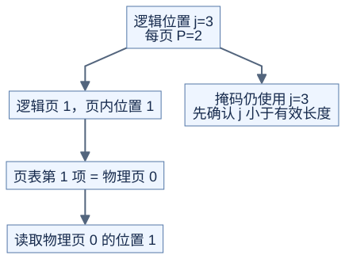

# 变长与分页：位置顺序和存储位置分开看

**Attention 需要按逻辑位置取 K、V，不要求它们物理上连续。** 前置：[Prefill、Decode 与 GQA](03-prefill-decode-gqa.md)、[张量步长](../../docs/prerequisites/02-tensors-and-layout.md)。本页只讨论地址和掩码，不讨论服务系统调度。

## 1. 变长序列如何放在一起

三条序列长度为 [2,0,3]，紧凑存储时累积边界为 [0,2,2,5]：

```text
原理示意
存储：     [a0 a1 | b0 b1 b2]
序列编号：    0    1为空   2
序列 s 的起点 = offsets[s]
序列 s 的长度 = offsets[s+1] - offsets[s]
```

Q、K 可以有不同长度，必须各有一份边界。批次之间不能互相看见；全局存储地址减去本序列起点，才是本序列的局部位置。空序列保持输出为空，不启动对空行求最大值的运算。

## 2. 因果掩码先约定位置

若 Q 是 K 对应序列的最后 Lq 个位置，局部查询 i 的位置为 `qpos=Lk-Lq+i`，只允许 `j<=qpos`。Lq=2、Lk=5 时：

```text
原理示意，1 表示可见
查询位置 3：1 1 1 1 0
查询位置 4：1 1 1 1 1
```

这是“右下对齐”的约定，FlashAttention 的相关接口采用这一约定；它不是所有 attention API 的统一规则。Lq>Lk 时开头可能整行不可见，本课约定该行输出与梯度为零。[FlashAttention 接口与掩码说明](https://github.com/Dao-AILab/flash-attention#21-change-behavior-of-causal-flag)

若是任意截取的查询段，直接传入真实 qpos；不能总用 Lk-Lq 推断。窗口注意力再加上 `qpos-left<=j<=qpos+right`，因果窗口还需与 `j<=qpos` 取交集。

## 3. 页表只改变地址计算

每页 P=2 个位置，逻辑页到物理页映射为 [2,0,3]，有效长度为 5：



[图源](figures/05-pages-01.mmd)

```text
逻辑位置 j=3
逻辑页 = j//P = 1
页内位置 = j%P = 1
物理页 = page_table[1] = 0
读取 cache[0,1,...]
```

示意缓存布局为 `[物理页, 页内位置, KV头, 维度]`；真实库可能顺序不同，必须使用实际 stride。页尾空位不能参加 Softmax，也不能用物理页号生成因果掩码。分页主要改善存储管理，不会自动减少数学运算量。[PagedAttention 论文](https://arxiv.org/abs/2309.06180)

## 4. 写入与共享也要有约定

Decode 加入新位置时，先确保相应页已分配并写入 K/V，再让读取它的计算继续。若使用不同 stream，需要显式依赖；“已提交写入”不等于“读取时已完成”。

多个请求可以共享只读前缀页；任一请求要修改共享内容前，必须由缓存管理层隔离写入，例如复制后修改。kernel 不应悄悄改掉其他请求的数据。本课 CPU 演示只验证只读寻址，不实现分配器或并发缓存更新。

## 自测与验证

P=2，页表 [2,0,3]，j=4 应读哪里？为什么不能读取 j=5？

<details>
<summary>答案</summary>

读物理页 3 的位置 0。虽然该物理页还有位置 1，但有效长度为 5，j=5 不属于序列。掩码仍按逻辑位置 4 计算。

</details>

[check_advanced_attention.py](../../tools/check_advanced_attention.py) 检查空序列边界、非连续页表、页尾污染值，以及分页与连续存储的输出一致性。
