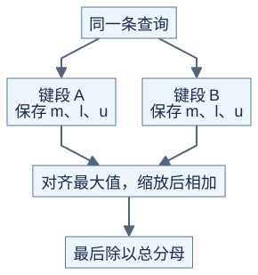

# 多块 Attention：不能直接平均局部输出

**每块必须保留“分母有多大”，才能正确合并。** 前置：[逐块 Softmax](01-online-softmax.md)。本页沿键的位置拆分同一条查询的计算，分块不重叠且覆盖全部有效键。

## 1. 为什么拆分

Decode 的查询行很少、历史很长时，可以把不同 K/V 段交给不同线程块，再用一次独立计算合并。这样增加并行任务，也增加局部结果的写入、读取和启动；短序列可能得不偿失。[FlashAttention 推理优化说明](https://github.com/Dao-AILab/flash-attention#22-optimize-for-inference)



[图源](figures/06-merge-01.mmd)

## 2. 合并最大值、分母和分子

每段保存 `m=max(s)`、`l=sum(exp(s-m))`、`u=sum(exp(s-m)*v)`。两段 a、b 的合并为：

```text
m = max(ma, mb)
a = exp(ma-m)，b = exp(mb-m)
l = a*la + b*lb
u = a*ua + b*ub
最终输出 o = u/l
```

u 可以是向量，每个分量都用同样的 a、b。相同公式可按顺序或树形合并多个段；实数下相等，浮点下不同合并顺序会有舍入差异。

空段用“无有效元素”状态表示，并在合并前跳过。不要对两个空段计算 `exp(-inf-(-inf))`；所有段都空时，按本课约定输出零。

## 3. 已经归一化的结果怎样合并

若每段只保留输出 `o_t=u_t/l_t` 和 `L_t=m_t+log(l_t)`，可写为：

```text
M = max(L_t)
w_t = exp(L_t-M)
o = sum(w_t*o_t) / sum(w_t)
```

L 是每行的 log-sum-exp 统计，不是序列长度。空段不进入这个最大值与求和。

手算：两段各只有一个分数，分别为 0 和 log(3)，V 分别为 2 和 10。局部输出为 2 和 10，但它们的权重是 1:3；结果为 8，直接平均会得到 6。

## 4. 把开销也算进去

若有 H 个查询头、Q 行查询、S 段、输出维度 Dv，每段保存一份 FP32 输出与一个 FP32 L，则临时数据约为 `4*H*Q*S*(Dv+1)` 字节，忽略对齐与其他统计。合并还要再次读这些结果。增加段数不保证速度持续上升。

独立的合并 kernel 在依赖满足后运行，比在普通 kernel 中假设“块 0 最后完成”更容易保证正确。若用其他跨块方案，需要另外证明同步与可前进性。

## 自测与验证

两段输出分别为 2、10，L 分别为 log(2)、log(6)，结果是多少？

<details>
<summary>答案</summary>

仍为 8；权重为 2:6。共同加一个常数到所有 L 不改变结果。

</details>

[check_advanced_attention.py](../../tools/check_advanced_attention.py) 对照完整稳定 Softmax，检查不同分段、合并顺序、极大分数、空段和整行掩码。
