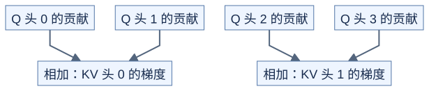

# 掩码、GQA 与 dropout 的反向

**掩码决定哪些路径存在；共享 K/V 的梯度要把所有使用者的贡献加起来。** 前置：[最简反向](04-backward.md)、[GQA](03-prefill-decode-gqa.md)、[位置约定](05-variable-length-and-pages.md)。本课只求 Q/K/V 梯度，掩码、位置和缩放规则固定。

## 1. 掩码先进入前向

对允许的位置计算 `P=softmax(QK.T/sqrt(D))`，其他位置 P=0。反向仍用逐行公式：

```text
dP = dO @ V.T
dS = P * (dP - sum(P*dP))
dQ = dS @ K / sqrt(D)
dK = dS.T @ Q / sqrt(D)
dV = P.T @ dO
```

不允许的位置 dS=0，因此不会把梯度传给相应分数。不能先对所有键做 Softmax 再把不可见权重置零，那样分母已经错了。整行屏蔽按本课约定视为恒零输出，所有输入梯度为零；这是显式定义，不是对未定义 Softmax 求导。

## 2. GQA：每个 Q 头独立算，共享处求和

Hq=4、Hkv=2 时，Q 头 0、1 使用 KV 头 0，Q 头 2、3 使用 KV 头 1：



[图源](figures/07-gqa-backward-01.mmd)

令每组 G=Hq/Hkv，则 Q 头 h 使用 `kv=h//G`。每头 dQ 单独保存；dK[kv] 和 dV[kv] 要**累加**同组每个查询头的贡献。写成覆盖赋值只会留下最后一个头。

不同查询块同样会贡献到相同 dK/dV。实现可先存局部结果再归约，或采用支持的原子累加；前者增加存储，后者需要考虑争用和累加顺序。不能让多个块无保护地写同一输出。

## 3. dropout 改变哪一条链路

训练中若使用 dropout，固定一次前向产生的 0/1 保留标记 R，丢弃概率 p 满足 `0<=p<1`：

```text
F = R/(1-p)
Pdrop = P*F
O = Pdrop @ V

dV = Pdrop.T @ dO
dP = (dO @ V.T)*F
之后仍用原 P 计算 Softmax 的 dS
```

分母仍来自 dropout 之前的 Softmax；丢弃后不重新归一化。反向要恢复同一批随机标记；只复用随机种子而改变生成次序，也未必得到相同标记。CPU 检查固定 F，不验证 GPU 随机数生成器。[FlashAttention 论文的重算与反向](https://arxiv.org/abs/2205.14135)

## 4. 怎样独立检查梯度

取标量目标 `loss=sum(O*dO)`，对每个 Q/K/V 元素做中心有限差分。检查时保持掩码、dropout 标记与页表不变，只扰动数值；在分页情况下梯度按寻址映射返回，若多个逻辑位置别名到同一可训练存储，还必须合并贡献。

本课梯度演示使用连续 K/V，分页只做独立的前向寻址检查。硬件低精度、原子操作和并发读写仍需实际 CUDA 验证。

## 自测与验证

一个 KV 头被两个 Q 头使用，它们对某个 K 元素的贡献为 2 和 -0.5。最终 dK 是多少？掩码位置的 dS 呢？

<details>
<summary>答案</summary>

dK=1.5，不能平均为 0.75。掩码位置 dS=0。带 dropout 时，应先把 F 乘到 dP，再经过 Softmax 反向，不能直接把整个 dS 乘 F。

</details>

运行 [check_advanced_attention.py](../../tools/check_advanced_attention.py)，覆盖非方阵因果掩码、窗口、整行屏蔽、多头共享与固定 dropout 的有限差分。
